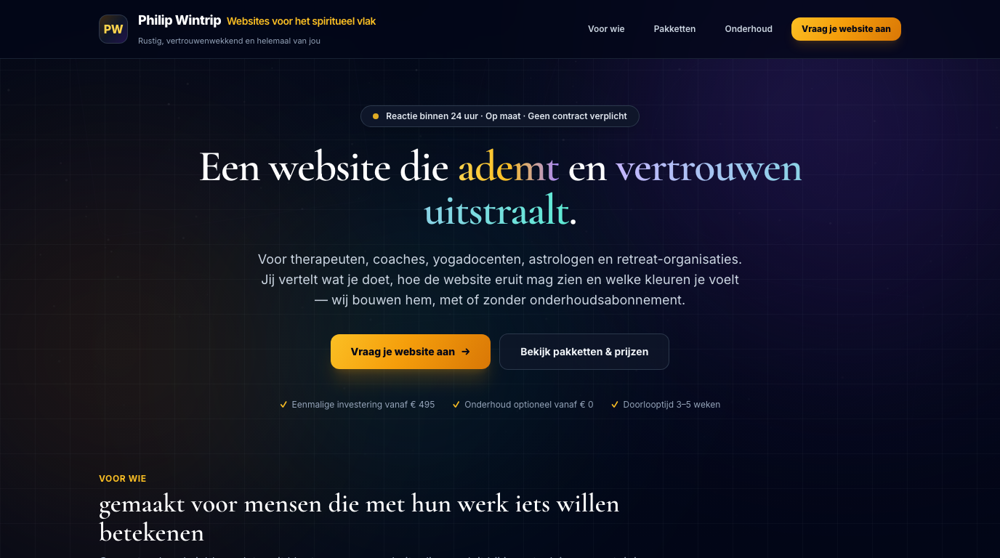
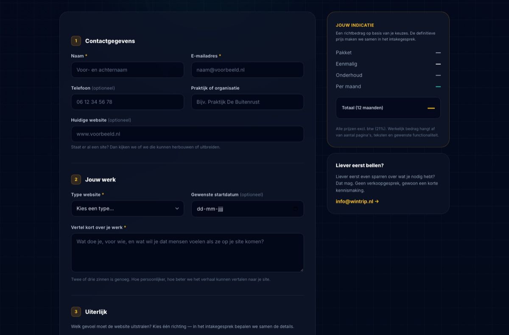

<p align="center">
  
</p>

<p align="center">
  <a href="https://philip-wintrip.com/web/"></a>
  
  
  
</p>

# Website-aanvraag — spiritueel vlak

Landingspagina met **aanvraagformulier** voor [Philip Wintrip](https://philip-wintrip.com/).
Bezoekers vullen één formulier in — contactgegevens, type website, gewenst uiterlijk,
kleur, functionaliteiten, websitepakket en onderhoudsabonnement — en de aanvraag komt
binnen bij **info@wintrip.nl**.

De stijl is dezelfde dark-mode Tailwind-taal als de
[`landingspagina`](https://github.com/pwintri2/landingspagina)-repo (`slate-950`, ambient
glows, technisch grid), met het palet verschoven naar **goud/amber + violet/teal** en
serif-koppen voor de doelgroep in het spiritueel vlak.

🌐 **Live:** https://philip-wintrip.com/web/

---

## Wat de bezoeker kiest

| Onderdeel | Opties |
|---|---|
| **Uiterlijk** | Minimalistisch & rustig · Warm & verzorgend · Mystiek & intiem · Modern & helder |
| **Kleur** | Aards · Zand & goud · Salie · Smaragd & bos · Lavendel & violet · Nachtblauw · Bloesemroze · Monochroom |
| **Type website** | Praktijkwebsite · Cursussen & lessen · Retreats · Webshop · Landingspagina · Community · Portfolio |
| **Functionaliteiten** | Contactformulier · Afsprakenplanner · Nieuwsbrief · Webshop/donatie · Cursustraining · Ledenlogin · Meertalig · Blog · Eigen domein · AVG-teksten |
| **Websitepakket** | Essentieel · Helder · Uitgelicht · Maatwerk |
| **Onderhoud** | Zelfbeheer · Zorgbasis · Zorg plus · Zorg groei |

De pagina toont tijdens het invullen een **live prijsindicatie** (eenmalige investering +
12 × maandprijs) in de zijbalk.

## Prijzen

Eenmalige investering (excl. btw):

| Pakket | Prijs | Inhoud |
|---|---|---|
| Essentieel | € 495 | 1 pagina, contactformulier, SSL, basis SEO |
| **Helder** *(meest gekozen)* | € 895 | Tot 5 pagina's, afsprakenplanner, CMS, nieuwsbrief |
| Uitgelicht | € 1.595 | Tot 10 pagina's, cursusmodule, webshop/donatie, meertalig |
| Maatwerk | vanaf € 2.395 | Ledenportaal, integraties, motion, volledig op maat |

Onderhoudsabonnement (per maand, maandelijks opzegbaar):

| Abonnement | Prijs | Inhoud |
|---|---|---|
| Zelfbeheer | € 0 | Eigen beheeromgeving, handleiding, 1 uur instructie |
| Zorgbasis | € 25 | Updates, back-ups, SSL, 1 uur support |
| **Zorg plus** *(meest gekozen)* | € 49 | + contentwijzigingen (2 uur), kwartaalreview |
| Zorg groei | € 89 | + 5 uur, lokale SEO, maandelijkse rapportage |

## Techniek

- **HTML5 + Tailwind CSS** (Play-CDN, geen build-stap) — zelfde aanpak als de `landingspagina`-repo
- **PHP-mailhandler** (`verzenden.php`) met validatie, honeypot tegen bots en `Reply-To` op de bezoeker
- **Progressieve fallback**: mét JavaScript JSON-antwoord, zonder JavaScript een redirect naar `?verzonden=1`
- **Geen database** — de aanvraag wordt uitsluitend per e-mail verwerkt (AVG-vriendelijk)
- **Eigen SVG-achtergrond** met sterrenveld, mandala-ringen en diffuse goud/violet glows

### Projectstructuur

```text
web/
├── index.html              # De pagina + het aanvraagformulier
├── verzenden.php           # PHP-mailhandler → info@wintrip.nl
├── index.php               # Wrapper voor hosts die alleen .php serveren
├── assets/
│   ├── hero-bg.svg         # Gelaagde donkere achtergrond (SVG)
│   ├── hero-banner.png     # Banner voor deze README
│   └── formulier-preview.png
└── README.md
```

## Het formulier in beeld

<p align="center">
  
</p>

<details>
<summary><strong>Installatie &amp; deployment</strong></summary>

1. Upload de bestanden naar de webmap van de site (bv. `/web/` op `philip-wintrip.com`).
2. Zorg dat PHP actief is en dat `mail()` werkt (SMTP/MTA op de host).
3. Test het formulier en controleer de mailbox van `info@wintrip.nl`.

**Afzender aanpassen (belangrijk)** — standaard verstuurt `verzenden.php` met
`From: website@wintrip.nl` en `Reply-To:` het adres van de bezoeker. Draait de site op
een ander domein, pas dan `AFZENDER` aan naar een mailbox op **hetzelfde** domein,
anders loopt de mail tegen SPF/DMARC van de ontvanger weg:

```php
const ONTVANGST = 'info@wintrip.nl';
const AFZENDER  = 'website@wintrip.nl';
```

**Zonder PHP** blijft de pagina volledig werken: het formulier toont dan een foutmelding
met een klikbare `mailto:`-link naar `info@wintrip.nl`.

**Prijzen aanpassen** — de prijzen staan op drie plekken: de pakketkaarten, de
onderhoudskaarten en de radio-opties in het formulier (`value="Helder — € 895"` plus
`data-prijs="895"` — die `data-prijs` gebruikt de live indicatie).

**AVG** — verplichte akkoordcheckbox, de bezoeker wordt geïnformeerd dat de gegevens
alleen voor de beantwoording van de aanvraag worden gebruikt. Er is geen database en
geen doorgifte aan derden.

</details>

---

*Gemaakt voor therapeuten, coaches, yogadocenten, astrologen en retreat-organisaties.*
